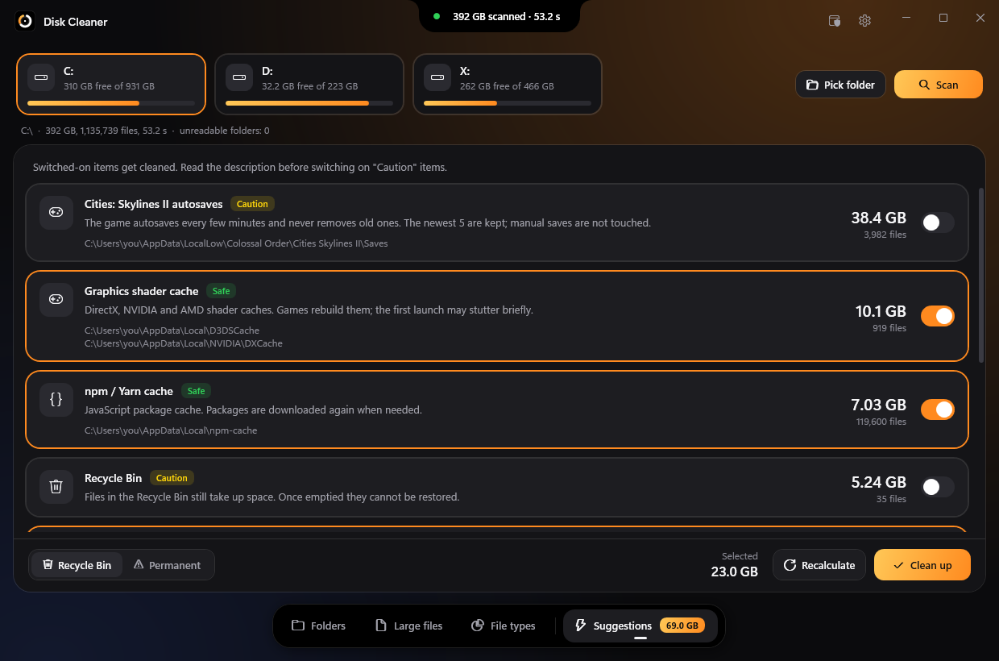
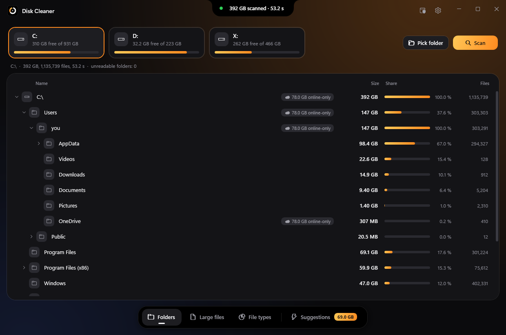
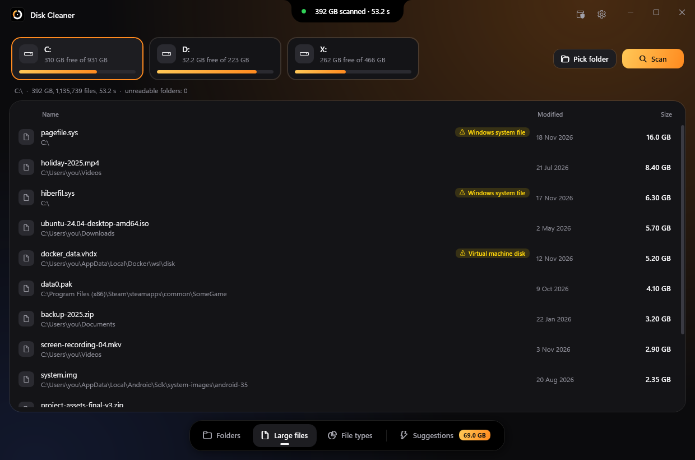
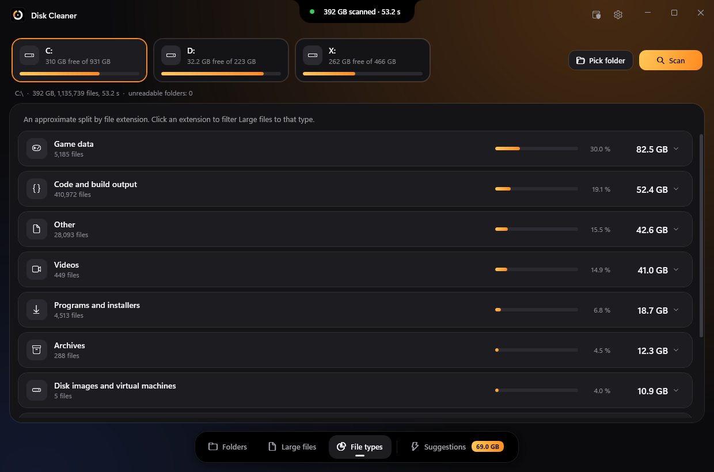

<p align="center">
  
</p>

<h1 align="center">Disk Temizleyici</h1>

<p align="center">
  <b>See what fills your disk. Clean it without fear.</b><br />
  A fast, careful disk space analyzer and cleaner for Windows.
</p>

<p align="center">
  <a href="https://github.com/sabriemin/disc-cleaner/actions/workflows/build.yml"></a>
  
  
  
  <a href="LICENSE"></a>
</p>

<p align="center">
  <a href="../../releases/latest"><b>Download</b></a> ·
  <a href="#features">Features</a> ·
  <a href="#safety-first">Safety</a> ·
  <a href="#cleanup-rules">Cleanup rules</a> ·
  <a href="#build-from-source">Build</a> ·
  <a href="README.tr.md">Türkçe</a>
</p>

<p align="center">
  
</p>

---

## Why

This started with a full `C:` drive and an afternoon of digging. The space wasn't going to a mystery: one game had
kept **3,992 autosaves, 131 GB**, and never deleted any of them. Its cache took another 38 GB, and the "73 GB"
phone-sync folder turned out to use no disk space at all, because all of it was online-only.

Disk Temizleyici does that digging for you. It scans a drive in under a minute, shows where the space really goes,
and knows which of those places are safe to clean.

## Features

| What you get | How |
| --- | --- |
| **A fast folder map** | Scans every folder in parallel (2.2 million files took 53 seconds in our test) and shows each folder's size, its share of the parent folder and its file count. Folders are sorted largest first. |
| **Honest numbers** | Junctions and symbolic links are not followed, so nothing is counted twice. OneDrive and Phone Link "online-only" files are shown with a ☁ tag and not counted, because they use no disk space. |
| **The largest files** | The 200 biggest files on the drive, with where they live and when they last changed. Whole-disk files (WSL, Docker, virtual machines) and Windows system files are tagged so nobody mistakes them for junk. |
| **File types** | How much space videos, disk images, installers, game data, code and so on take, per extension. Click an extension to filter the largest files to it. |
| **Unaccounted space** | On a whole-drive scan, one row shows the used space the scan could not see (restore points, NTFS records, folders without permission), so the numbers add up. |
| **Cleanup suggestions** | Temp files, shader caches, package caches (npm, pip, NuGet, Gradle), browser caches, crash dumps, Windows Update leftovers, the Recycle Bin, and runaway game autosaves. Each one shows its size, what it is and how risky it is. |
| **Undo by default** | Cleaning moves files to the Recycle Bin unless you choose *Permanent*. |
| **Island and dock** | A notch-style status island, a bottom dock and spring animations. You can choose a solid or Windows 11 glass look and one of six accent colours. |
| **Two languages** | English and Türkçe. The app follows your Windows language, and you can switch in Settings. |

<p align="center">
  
  
</p>
<p align="center">
  
</p>

## Download

Grab the latest build from [**Releases**](../../releases/latest):

| File | When to use it |
| --- | --- |
| `DiskTemizleyici.exe` | Small download. Needs the [.NET 10 Desktop Runtime](https://dotnet.microsoft.com/download/dotnet/10.0); if it is missing, the program shows a download link on first run. |
| `DiskTemizleyici-standalone.exe` | Bigger download, but needs nothing else installed. |

No installer is needed. Put the file anywhere and run it.

> **SmartScreen:** the program isn't code-signed yet, so Windows may show *"Windows protected your PC"*.
> Click **More info → Run anyway**. The whole source is here, and the release files are built by
> [GitHub Actions](.github/workflows/build.yml) straight from this repository.

## Safety first

A disk cleaner should never be the reason you lose something. Disk Temizleyici works like this:

- **Nothing is deleted without asking.** Every clean-up first shows what will be cleaned and how much. For permanent
  deletion, *Cancel* is the default button.
- **The Recycle Bin by default.** Permanent deletion is a separate, clearly marked choice.
- **Protected locations are never deleted**, whatever a rule or a click says: drive roots, `Windows` (except its
  `Temp`, Windows Update download and crash dump folders `Minidump` and `LiveKernelReports`), `Program Files`,
  `ProgramData`, `System Volume Information`, `Recovery`, and the main folders of **every** account on the PC (the user folder, `AppData`, `Desktop`, `Documents`, `Downloads`,
  `Pictures`, `Music`, `Videos`, …). Files *inside* those folders can be deleted, but the folders themselves can't.
  Paths are checked in every form that reaches the same place (`\\?\` prefixes, 8.3 short names, junctions, SUBST
  drives), and network paths are never deleted.
- **Cloud folders are off limits.** Nothing inside OneDrive or another cloud sync folder is deleted, because deleting
  there deletes it in the cloud and on your other devices too.
- **Whole-disk files get a second warning.** A WSL or Docker disk (`.vhdx`) or a virtual machine disk is the entire
  contents of a computer, so deleting one needs two confirmations. Windows' own `pagefile.sys`, `hiberfil.sys` and
  `swapfile.sys` cannot be deleted at all, and `Windows.old` is left to Settings › System › Storage.
- **USB sticks have no Recycle Bin.** On such drives the app says so before deleting, because there "move to the
  Recycle Bin" really deletes.
- **Links are removed, never followed.** Deleting a junction removes the link, not the folder it points to.
- **Files in use are skipped**, not forced.
- **Risky suggestions start switched off.** Anything marked *Caution* (the Recycle Bin, game saves, build caches) is
  only cleaned if you switch it on.
- **No network, no telemetry.** The app never connects to the internet. Crash reports and a small diagnostics log stay
  in `%LOCALAPPDATA%\DiskTemizleyici\logs` with your user name and computer name removed; "Report on GitHub" only opens
  your browser if you click it.

## Cleanup rules

| Rule | Risk | What it cleans |
| --- | --- | --- |
| User temporary files | Safe | `%TEMP%`, only files older than 24 hours |
| Windows temporary files | Safe · admin | `C:\Windows\Temp`, only files older than 24 hours |
| Crash reports | Safe | `CrashDumps`, Windows Error Reporting archives |
| Graphics shader cache | Safe | DirectX, NVIDIA, AMD shader caches |
| Steam shader cache | Safe | `steamapps\shadercache` |
| Browser cache | Safe | Chrome, Edge, Brave, Opera, Firefox caches (never passwords, history or logins) |
| npm / Yarn, pip, NuGet caches | Safe | Package download caches |
| Gradle cache | Caution | `~\.gradle\caches` (the next build downloads everything again) |
| Windows Update downloads | Caution · admin | `SoftwareDistribution\Download`, files older than 7 days |
| Recycle Bin | Caution | Empties the bin |
| Cities: Skylines II autosaves | Caution | Keeps the newest 5 autosaves; manual saves are never touched |
| Cities: Skylines II cache | Caution | The game's `.cache` folder |
| Microsoft Teams cache | Safe | HTTP, code and GPU caches of new and classic Teams (not chats, backgrounds or logs) |
| Discord / Slack cache | Safe | The apps' caches (not logins, settings or messages) |
| Visual Studio Code caches | Safe | Caches, old code caches, downloaded extension packages, crash dumps |
| Steam web cache and logs | Safe | The store and library browser cache, Steam logs and crash dumps |
| Epic Games Launcher cache | Safe | Web caches and logs (not site data or your login) |
| Windows crash dumps | Caution · admin | Blue-screen and live kernel dumps older than 7 days (keep them while you investigate a crash) |

### Adding a cleanup rule

Rules are plain JSON in [`src/DiskTemizleyici.Core/Cleanup/rules.json`](src/DiskTemizleyici.Core/Cleanup/rules.json).
Adding a new place to clean only takes a new entry:

```json
{
  "id": "my-game-autosaves",
  "mode": "Files",
  "risk": "Caution",
  "pattern": "autosave*",
  "keepNewest": 3,
  "paths": [ "%USERPROFILE%\\Saved Games\\MyGame" ],
  "name": { "tr": "MyGame otomatik kayıtları", "en": "MyGame autosaves" },
  "description": { "tr": "…", "en": "Keeps the 3 newest autosaves." }
}
```

| Field | Meaning |
| --- | --- |
| `mode` | `Contents` empties a folder but keeps the folder itself. `Files` deletes files matching `pattern`. `RecycleBin` empties the Recycle Bin. |
| `paths` | Folders the rule applies to. Environment variables are expanded, and `*` matches any folder name (e.g. every browser profile). |
| `keepNewest` | `Files` mode: keep this many of the newest matches in each folder. `save1.cok` and `save1.cok.cid` count as one save. |
| `minAgeDays` | Skip anything changed more recently than this. |
| `risk` | `Safe` items are switched on by default; `Caution` items are not. |
| `needsAdmin` | Shows an *admin* tag; cleaning usually needs *Restart as administrator*. |

You can also drop a `rules.json` **next to the program** to add rules or replace a built-in one with the same `id`,
without rebuilding. Pull requests with new rules are very welcome.

## Command line

```bash
DiskTemizleyici.exe "D:\Games"
```

This opens the app and starts scanning that folder right away.

## Keyboard

| Key | Does |
| --- | --- |
| `Del` / `Shift+Del` | Move the selected folder or file to the Recycle Bin / delete it permanently (always asks first) |
| `Enter` | Show it in Explorer |
| `Ctrl+C` | Copy its path |
| `F5` | Rescan the selected folder (with no folder selected: scan again what was scanned last; in Suggestions: check them again) |
| `Esc` | Stop a scan, a suggestion check, a clean-up or a rescan |
| `Ctrl+1` … `Ctrl+4` | Folders, Large files, File types, Suggestions |
| `Shift+F10` / Menu key | The right-click menu of the selected row |
| `Space` | Switch a suggestion on or off |

## Build from source

You need the [.NET 10 SDK](https://dotnet.microsoft.com/download/dotnet/10.0) on Windows. [`global.json`](global.json)
pins it, so install the standalone .NET 10 SDK even if Visual Studio brought a newer one.

```bash
git clone https://github.com/sabriemin/disc-cleaner.git
cd disc-cleaner
dotnet test
dotnet run --project src/DiskTemizleyici.App
```

Single-file builds, as on the Releases page:

```bash
dotnet publish src/DiskTemizleyici.App -c Release -r win-x64 --self-contained false -p:PublishSingleFile=true -o publish
```

| Folder | What's inside |
| --- | --- |
| `src/DiskTemizleyici.Core` | Scanner, cleanup rules, safety guard, deletion. No UI, fully unit-tested. |
| `src/DiskTemizleyici.App` | The WPF app: theme, island, dock, view models, translations (`Localization/Loc.cs`). |
| `tests/DiskTemizleyici.Tests` | xUnit tests: sizes, junctions, rules, autosave grouping, and the safety guard. |
| `tools/AssetGen` | Renders the logo into `app.ico` and `docs/logo.png`. |

**Screenshots without your own files:** set `DISKTEMIZLEYICI_DEMO=en` (or `tr`) before starting the app. It then
shows made-up example data, and deleting is switched off.

### Translations

All text lives in [`Localization/Loc.cs`](src/DiskTemizleyici.App/Localization/Loc.cs), and rule texts live in
`rules.json`. Adding a language today means adding its text to every entry there and a button to the language
picker; moving the text to one file per language is planned.

## Credits

The island-and-dock look is inspired by [Nectar](https://github.com/kua8/Nectar) by kua8, a lovely notch and dock for
Windows. No code or artwork was taken from it; everything here is written from scratch.

## License

[MIT](LICENSE)
