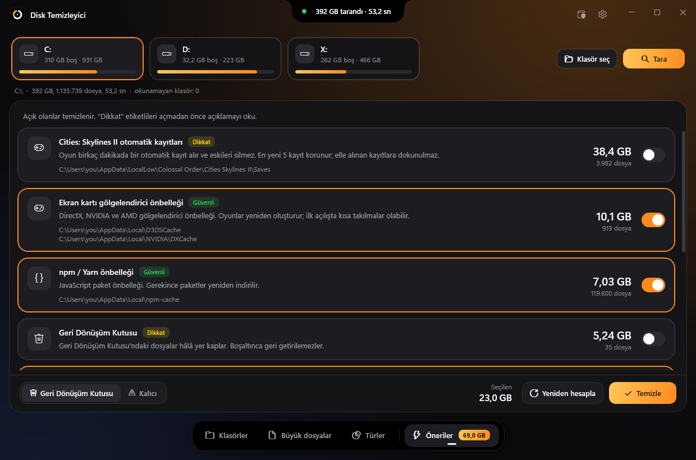

<p align="center">
  
</p>

<h1 align="center">Disk Temizleyici</h1>

<p align="center">
  <b>Diskini neyin doldurduğunu gör. Korkmadan temizle.</b><br />
  Windows için hızlı ve dikkatli bir disk alanı analiz ve temizlik aracı.
</p>

<p align="center">
  <a href="https://github.com/sabriemin/disc-cleaner/actions/workflows/build.yml"></a>
  
  
  
  <a href="LICENSE"></a>
</p>

<p align="center">
  <a href="../../releases/latest"><b>İndir</b></a> ·
  <a href="#özellikler">Özellikler</a> ·
  <a href="#önce-güvenlik">Güvenlik</a> ·
  <a href="#temizlik-kuralları">Kurallar</a> ·
  <a href="#kaynaktan-derleme">Derleme</a> ·
  <a href="README.md">English</a>
</p>

<p align="center">
  
</p>

---

## Neden

Her şey dolu bir `C:` sürücüsüyle başladı. Yer gizemli bir şeye gitmiyordu: tek bir oyun **3.992 otomatik kayıt, yani
131 GB** biriktirmiş ve hiçbirini silmemişti. Oyunun önbelleği 38 GB daha tutuyordu. "73 GB" görünen telefon
eşitleme klasörü ise aslında hiç yer kaplamıyordu, çünkü dosyaların hepsi yalnızca çevrimiçiydi.

Disk Temizleyici bu araştırmayı senin yerine yapar. Bir sürücüyü bir dakikadan kısa sürede tarar, yerin gerçekte
nereye gittiğini gösterir ve bu yerlerden hangilerinin güvenle temizlenebileceğini bilir.

## Özellikler

| Ne sunar | Nasıl |
| --- | --- |
| **Hızlı klasör haritası** | Tüm klasörleri paralel tarar (testimizde 2,2 milyon dosya 53 saniye sürdü). Her klasörün boyutunu, üst klasördeki payını ve dosya sayısını büyükten küçüğe sıralı gösterir. |
| **Dürüst rakamlar** | Junction ve sembolik bağlantıları izlemez, böylece hiçbir şey iki kez sayılmaz. OneDrive ve Telefon Bağlantısı'nın "yalnızca çevrimiçi" dosyalarını ☁ etiketiyle ayrı gösterir ve toplama katmaz, çünkü diskte yer kaplamazlar. |
| **En büyük dosyalar** | Sürücüdeki en büyük 200 dosyayı, nerede durduklarını ve en son ne zaman değiştiklerini listeler. Bütün bir diski taşıyan dosyalar (WSL, Docker, sanal makineler) ve Windows sistem dosyaları etiketlenir; kimse onları çöp sanmaz. |
| **Dosya türleri** | Videoların, disk görüntülerinin, kurulum dosyalarının, oyun verilerinin, kodun … ne kadar yer kapladığını uzantı uzantı gösterir. Bir uzantıya tıklayınca büyük dosyalar o türe süzülür. |
| **Hesaba katılmayan alan** | Sürücü taramasında, taramanın göremediği dolu alanı (geri yükleme noktaları, NTFS kayıtları, izin olmayan klasörler) ayrı bir satırda gösterir; rakamlar böylece tutar. |
| **Temizlik önerileri** | Geçici dosyalar, gölgelendirici önbellekleri, paket önbellekleri (npm, pip, NuGet, Gradle), tarayıcı önbelleği, çökme raporları, Windows Update artıkları, Geri Dönüşüm Kutusu ve kontrolden çıkmış oyun kayıtları. Her öneri boyutunu, ne olduğunu ve risk düzeyini gösterir. |
| **Varsayılan olarak geri alınabilir** | *Kalıcı* seçilmedikçe dosyalar Geri Dönüşüm Kutusu'na taşınır. |
| **Ada ve dock** | Çentik tarzı bir durum adası, altta bir dock ve yaylı animasyonlar. Düz ya da Windows 11 cam görünümü ve altı vurgu rengi arasından seçim yapılabilir. |
| **İki dil** | Türkçe ve İngilizce. Windows dilini izler; Ayarlar'dan değiştirilebilir. |

## İndir

Son sürümü [**Releases**](../../releases/latest) sayfasından indir:

| Dosya | Ne zaman |
| --- | --- |
| `DiskTemizleyici.exe` | Küçük dosya. [.NET 10 Desktop Runtime](https://dotnet.microsoft.com/download/dotnet/10.0) gerekir; kurulu değilse program ilk açılışta indirme bağlantısı gösterir. |
| `DiskTemizleyici-standalone.exe` | Daha büyük dosya, ama başka hiçbir şey kurmak gerekmez. |

Kurulum gerekmez. Dosyayı istediğin yere koy ve çalıştır.

> **SmartScreen:** Program henüz kod imzalı değil, bu yüzden Windows *"Windows bilgisayarınızı korudu"* diyebilir.
> **Ek bilgi → Yine de çalıştır**'a tıkla. Kaynak kodun tamamı burada; sürüm dosyaları doğrudan bu depodan
> [GitHub Actions](.github/workflows/build.yml) ile derlenir.

## Önce güvenlik

- **Sormadan hiçbir şey silinmez.** Her temizlikten önce neyin temizleneceği ve ne kadar yer açılacağı gösterilir. Kalıcı silmede varsayılan düğme *Vazgeç*'tir.
- **Varsayılan: Geri Dönüşüm Kutusu.** Kalıcı silme ayrı ve açıkça işaretli bir seçimdir.
- **Korunan konumlar asla silinmez:** sürücü kökleri, `Windows` (yalnızca `Temp`, Windows Update indirme klasörü ve
  çökme dökümü klasörleri `Minidump`, `LiveKernelReports` hariç),
  `Program Files`, `ProgramData`, `System Volume Information`, `Recovery` ve bilgisayardaki **her** hesabın ana
  klasörleri (kullanıcı klasörü, `AppData`, `Masaüstü`, `Belgeler`, `İndirilenler`, `Resimler`, `Müzik`, `Videolar` …).
  Bu klasörlerin *içindekiler* silinebilir, kendileri silinemez. Yollar aynı yere varan her biçimiyle denetlenir
  (`\\?\` önekleri, 8.3 kısa adlar, junction'lar, SUBST sürücüler); ağ yolları hiç silinmez.
- **Bulut klasörlerine dokunulmaz.** OneDrive gibi buluta eşitlenen klasörlerin içindeki hiçbir şey silinmez; orada
  silmek bulutta ve diğer cihazlarında da silmek demektir.
- **Bütün bir diski taşıyan dosyalar ikinci kez sorulur.** WSL ya da Docker diski (`.vhdx`) veya bir sanal makine diski
  bir bilgisayarın içeriğinin tamamıdır; silmek iki onay ister. Windows'un kendi `pagefile.sys`, `hiberfil.sys` ve
  `swapfile.sys` dosyaları hiç silinemez; `Windows.old` için Ayarlar › Sistem › Depolama kullanılır.
- **USB belleklerde Geri Dönüşüm Kutusu yoktur.** Böyle sürücülerde uygulama silmeden önce bunu söyler, çünkü orada
  "Geri Dönüşüm Kutusu'na taşı" aslında silmek demektir.
- **Bağlantılar izlenmez.** Bir junction silindiğinde yalnızca bağlantı kaldırılır, gösterdiği klasöre dokunulmaz.
- **Kullanımdaki dosyalar atlanır**, zorla silinmez.
- **Riskli öneriler kapalı başlar.** *Dikkat* etiketliler (Geri Dönüşüm Kutusu, oyun kayıtları, derleme önbellekleri) ancak sen açarsan temizlenir.
- **İnternet yok, izleme yok.** Uygulama internete hiç bağlanmaz. Hata raporları ve küçük bir tanılama günlüğü,
  kullanıcı adın ve bilgisayar adın çıkarılarak `%LOCALAPPDATA%\DiskTemizleyici\logs` klasöründe kalır; "GitHub'da bildir"
  yalnızca sen tıklarsan tarayıcını açar.

## Temizlik kuralları

Kurallar [`rules.json`](src/DiskTemizleyici.Core/Cleanup/rules.json) dosyasında düz JSON olarak durur. Yeni bir yer
eklemek için bir kayıt eklemek yeter; alanların açıklaması [İngilizce README](README.md#adding-a-cleanup-rule)'de.
Programın yanına bir `rules.json` koyarak yeniden derlemeden kural ekleyebilir ya da aynı `id`'li hazır bir kuralı
değiştirebilirsin. Yeni kurallar içeren pull request'ler memnuniyetle karşılanır.

## Komut satırı

```bash
DiskTemizleyici.exe "D:\Oyunlar"
```

Uygulama açılır ve o klasörü taramaya hemen başlar.

## Klavye

| Tuş | Ne yapar |
| --- | --- |
| `Del` / `Shift+Del` | Seçili klasörü ya da dosyayı Geri Dönüşüm Kutusu'na taşır / kalıcı siler (her zaman önce sorar) |
| `Enter` | Gezgin'de gösterir |
| `Ctrl+C` | Yolunu kopyalar |
| `F5` | Seçili klasörü yeniden tarar (seçili klasör yoksa son taranan yeri yeniden tarar; Öneriler'de önerileri yeniden denetler) |
| `Esc` | Taramayı, öneri kontrolünü, temizliği ya da yeniden taramayı durdurur |
| `Ctrl+1` … `Ctrl+4` | Klasörler, Büyük dosyalar, Türler, Öneriler |
| `Shift+F10` / Menü tuşu | Seçili satırın sağ tık menüsü |
| `Boşluk` | Bir öneriyi açar ya da kapatır |

## Kaynaktan derleme

Windows'ta [.NET 10 SDK](https://dotnet.microsoft.com/download/dotnet/10.0) gerekir. [`global.json`](global.json)
sürümü sabitlediği için Visual Studio daha yeni bir SDK kurmuş olsa bile ayrıca .NET 10 SDK'sını kur.

```bash
git clone https://github.com/sabriemin/disc-cleaner.git
cd disc-cleaner
dotnet test
dotnet run --project src/DiskTemizleyici.App
```

Kendi dosyalarını göstermeden ekran görüntüsü almak için uygulamayı başlatmadan önce `DISKTEMIZLEYICI_DEMO=tr`
(ya da `en`) ortam değişkenini ayarla. Uygulama örnek verilerle açılır ve silme kapalı olur.

## Teşekkür

Ada ve dock görünümü kua8'in Windows için yaptığı güzel çentik ve dock uygulaması
[Nectar](https://github.com/kua8/Nectar)'dan esinlenmiştir. Ondan kod ya da görsel alınmamıştır; buradaki her şey
sıfırdan yazıldı.

## Lisans

[MIT](LICENSE)
